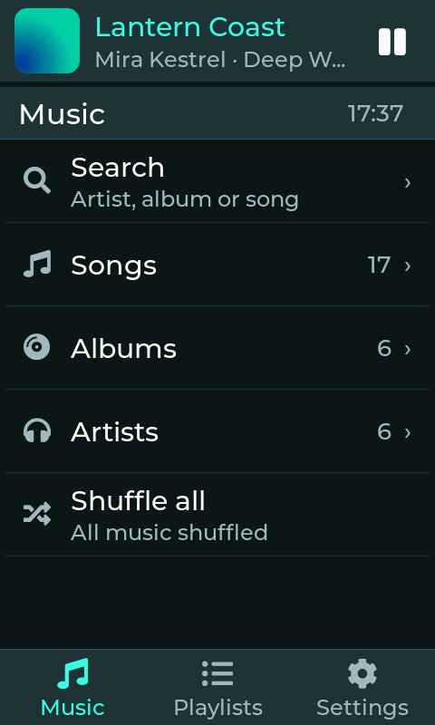
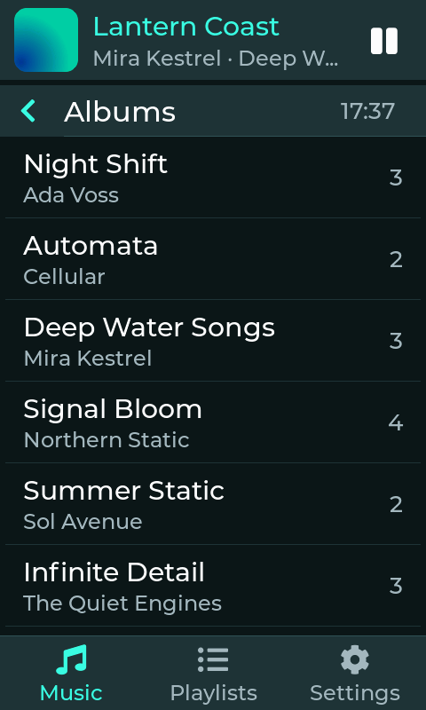
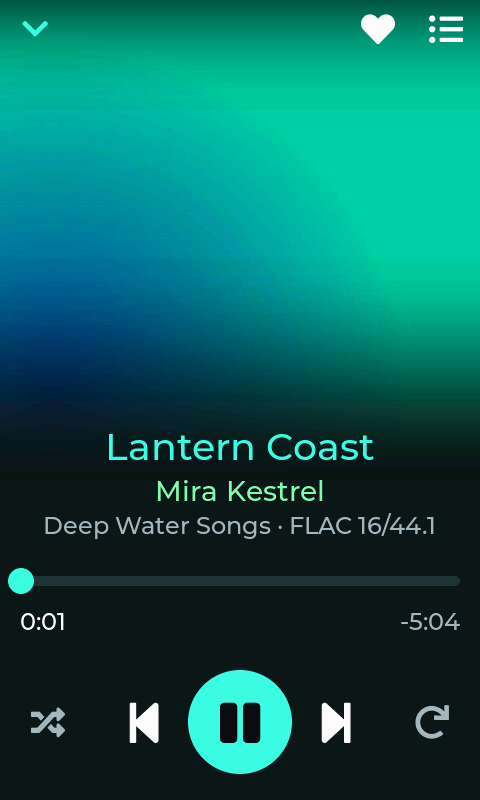
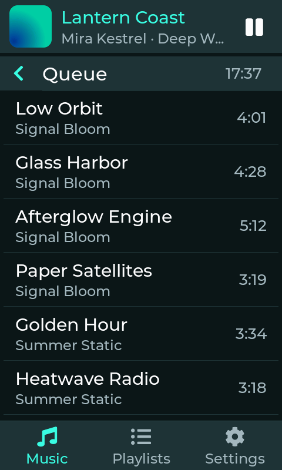
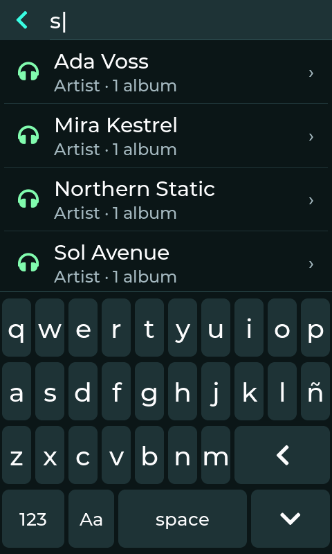
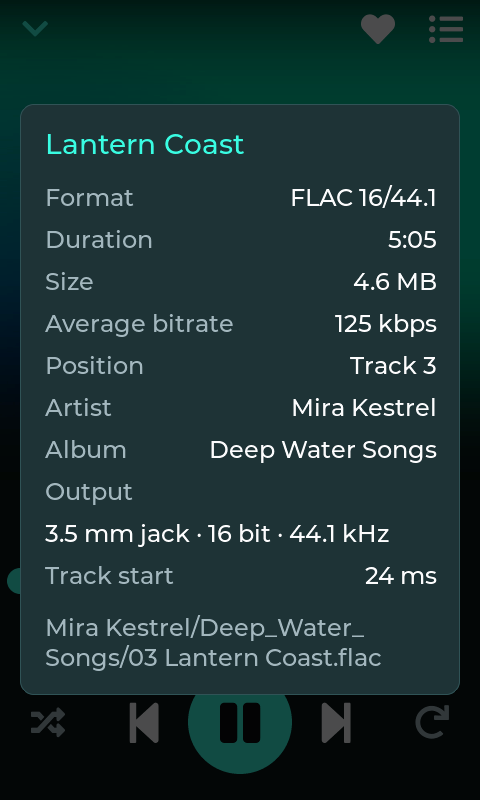
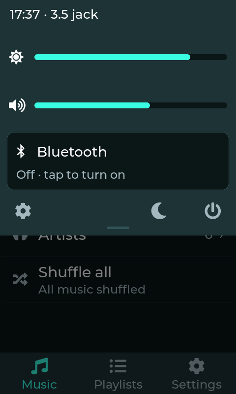
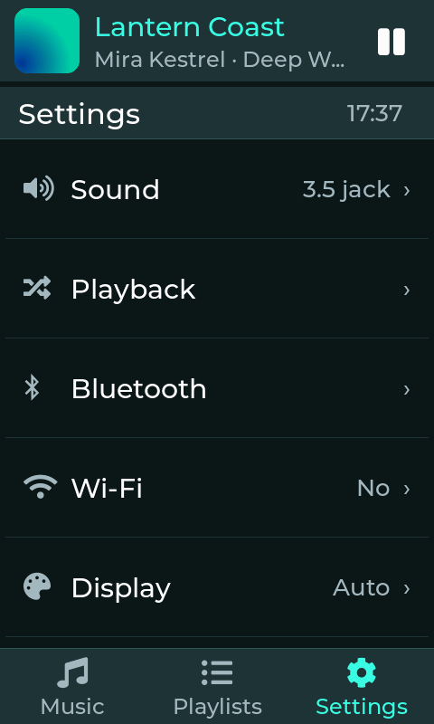
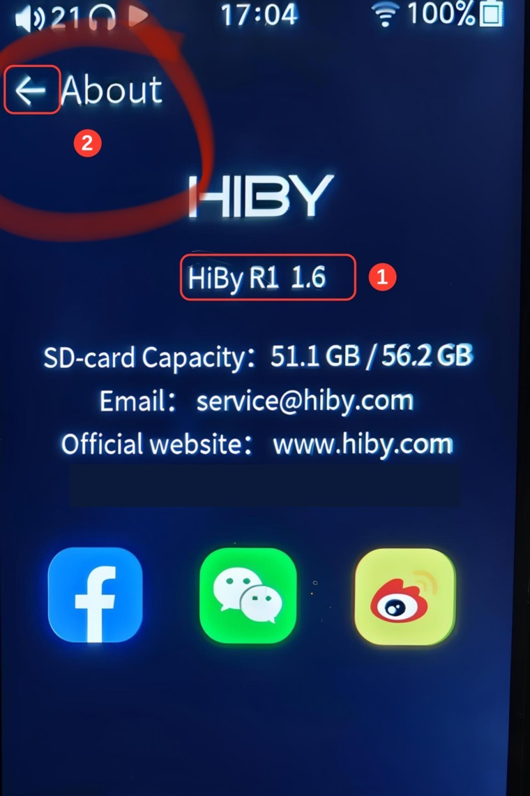

# SLP OS

A music player system for the HiBy R1 (Ingenic X1600, MIPS32r2, Cirrus Logic CS43131 DAC). It installs next to the
stock firmware, which stays untouched, and you can switch between both at any time.

Personal hobby project. The name is a nod to AI slop: the code was written with heavy use of AI coding assistants.

<p>
  
  
  
  
</p>
<p>
  
  
  
  
</p>

<sub>Simulator screenshots with a demo library (fictional artists, generated covers).</sub>

> **Before you start.** Experimental software, use at your own risk; not affiliated with HiBy Music.
> Keep the volume low before pressing play, especially with sensitive headphones.

## Install

You need the R1 on stock firmware with at least 50 % battery, a FAT32 or exFAT microSD with at least 500 MB free
besides your music (see [How much space it takes](#how-much-space-it-takes)), and a computer
(Windows, macOS or Linux) with Python 3 and [`adb`](https://developer.android.com/tools/releases/platform-tools).

1. Download `slp-os-<version>.zip` from [Releases](https://github.com/darwinmoralesmz/slp-os/releases) and unzip it.
2. On the R1, open Settings > About and tap the version line (**HiBy R1 1.6** in the picture) ten times (1): an ADB switch appears on that same page. Turn
   it on and go back with the arrow (2). HiBy turns ADB off on every restart, so repeat this whenever you need it.

   

3. Connect the R1 by USB, open a terminal in the unzipped folder and run:
   ```sh
   python3 installer.py install
   ```

   Using an AI assistant? Give it `AGENTS.md` from this folder and it will do the rest (and tell you when
   it needs your confirmation).

The installer takes about 3 minutes. It first backs up the whole NAND to `~/hiby-r1-backup/` (keep that folder: it is
what lets you uninstall), then copies the system to the microSD, prepares slot B on the device and asks before writing
it. When it finishes, it offers to restart into the new system.

Leave the R1 connected and untouched until the installer finishes: ADB has to stay on the whole time, and on stock
HiBy it turns off on every restart. In phase 4 the HiBy screen freezes for about a minute and a half (its player is
stopped to free memory for building slot B) and the R1 restarts at the end. If the connection drops, because of the
cable or because the R1 restarted, enable ADB again and run the same command: the steps already done are skipped.

### How much space it takes

| Where | What | Size |
|---|---|---|
| microSD | The system: app, Bluetooth/Wi-Fi files copied from your R1, Noto fonts | about 40 MB, fixed |
| microSD | Cover cache: each album's cover, ready to draw | about 0.45 MB per album, up to 300 MB |
| microSD | Library index and waveforms | about 1.2 KB per song (12 MB for 10 000 songs) |
| microSD | Temporary files during the installation (deleted at the end) | up to about 50 MB at a time |
| Computer | NAND backup in `~/hiby-r1-backup/` and the unzipped release | about 125 MB + 20 MB |
| R1 memory | Slot B reuses HiBy's recovery partition | nothing extra |

The cover cache is what grows: the first time you open each album its cover is decoded and resized once, and stored
so that scrolling and changing albums stay fast. When it reaches 300 MB the oldest covers are deleted. In practice,
leave about **400 MB free** on the card besides your music (for 650 albums or more, the cache stays at its 300 MB limit).
The cache can be deleted at any time (`r1os/cache/`); it is rebuilt as you browse.

### Updating, switching and uninstalling

```sh
python3 installer.py update      # after unzipping a new version; the backup and slot B are kept
python3 installer.py boot        # from stock HiBy (ADB on): restart into SLP OS
python3 installer.py uninstall   # from stock HiBy (ADB on): restore slot B and remove the system from the microSD
```

To go back to stock, choose "Restart into HiBy" in the power menu. Your music in `music/` is never touched. With several
devices connected, pick one with `-s SERIAL`; `-y` answers every question with yes.

## Using it

The screen has a mini-player at the top, the list in the middle and a fixed section bar at the bottom.

- **Quick panel.** Drag down from the top-left corner. Half open it shows time, weather, battery, output and brightness;
  fully open it adds volume, the Bluetooth card (tap to reconnect or disconnect, hold for Bluetooth settings),
  Settings, stand-by and the power menu (Power off, Restart, Restart into HiBy, Screen off).
- **Player.** Taps are counted: one pauses or resumes, two skip forward, three go back. The same works on the right side
  of the mini-player. Hold for the technical sheet: codec, average bitrate, sample rate and file path.
- **Lists.** Swipe a song to the right to add it to the end of the queue, or to the left to remove it from the queue,
  a playlist or Favorites. Long-press to select several items and act on them from the bottom bar (play now, play next,
  add to a playlist, favorite and more).
- **Search.** Matches artists, albums and songs as you type; drag the results to hide the keyboard.
- **Buttons.** Volume up and down work as usual; the level is shown on screen and kept after powering off (the first
  time it starts low, at 20 of 100). The power button turns the screen off and on with one press, **goes back to the
  Music home with two quick presses** (closing any panel or dialog), and opens the power menu when held. The track
  buttons skip with a press and seek through the song when held. There is no physical play/pause: tap the player screen.

## Features

- FLAC, MP3, AAC and ALAC (M4A), Vorbis, Opus and WAV, played at 16 bits.
- Headphone jack and Bluetooth (SBC and AAC tested; LDAC and aptX untested), with AVRCP controls.
- Library by albums, artists and songs with cover art, favorites, play queue and `.m3u8` playlists in `music/Listas`.
- Spanish and English, light and dark themes with an accent color taken from the cover.
- Auto power-off after 10 or 30 minutes without playback (configurable, or "Never").
- Not yet tested on the device: Wi-Fi settings, "Music over Wi-Fi" and USB disk mode.

## How it works

The R1 has two system slots. Stock HiBy lives in slot A; SLP OS boots from slot B, which HiBy uses for recovery. The
installer rebuilds that slot on your own device from HiBy's recovery image plus one init script (`slotB/overlay`), and
copies the Bluetooth, Wi-Fi and audio files from your device's stock system, so nothing from HiBy is redistributed.
Everything else, the app included, lives on the microSD: in `r1os/`, or on a second partition if you create one with
`scripts/sd_partition.sh` (2 GiB, which leaves plenty of room for the cache). Of the ~40 MB of the system, 1.8 MB is
the app, about 12 MB the Bluetooth, Wi-Fi and audio files and 23 MB the Noto fonts (the CJK one alone is 17.5 MB).

Slot B clears the boot flag as it starts and the app sets it again after 30 seconds. If the system hangs before that,
the next power-on falls back to stock HiBy.

## Development

Building needs Linux. `scripts/setup.sh` downloads the toolchain and libraries; then `make -C ui r1` builds the app,
`make -C ui sim` builds a desktop simulator, `scripts/deploy.sh` pushes the app to a connected R1 and
`scripts/package.sh <version>` builds the release zip. Bundled libraries and versions are listed in
`third_party/VERSIONS.md`.

## Credits

- Prior work: `bahusoid/rockbox` (HiBy R1 port), `bidhata/Hiby-R1-Mod`, `Meowby-R1`, `hiby_os_crack`, `open_hiby_player`.
- Libraries: LVGL, FAAD2, libopus, minimp3, dr_flac, dr_wav, stb_vorbis, stb_image, minimp4, the ALAC decoder by
  David Hammerton (via Rockbox) and musl.
- Fonts: Montserrat, Font Awesome and Noto.
- Releases include `mksquashfs` from squashfs-tools 4.7.5 and LZO 2.10 (`scripts/build_mksquashfs.sh`).

## License

GPL-2.0 (see `LICENSE`), since the app links FAAD2. Third-party files keep their own licenses.
